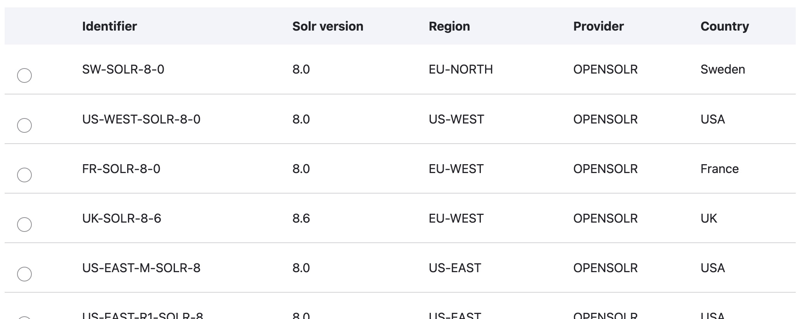
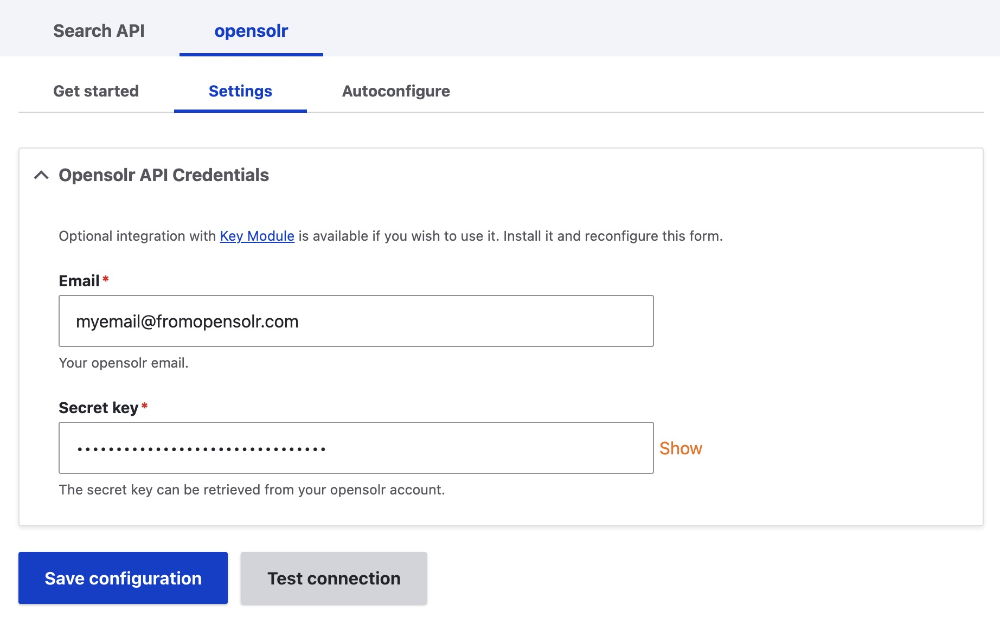
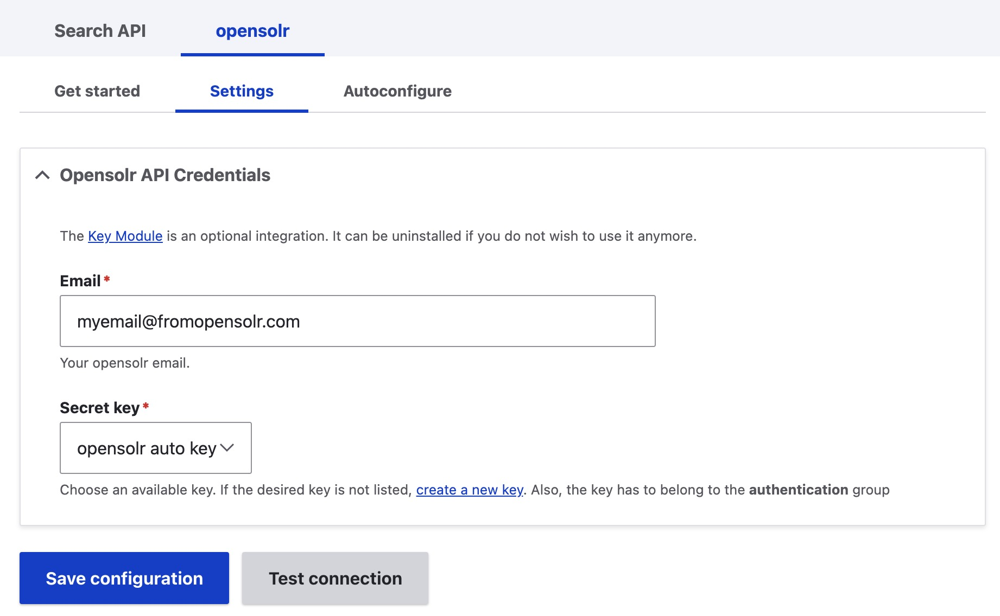
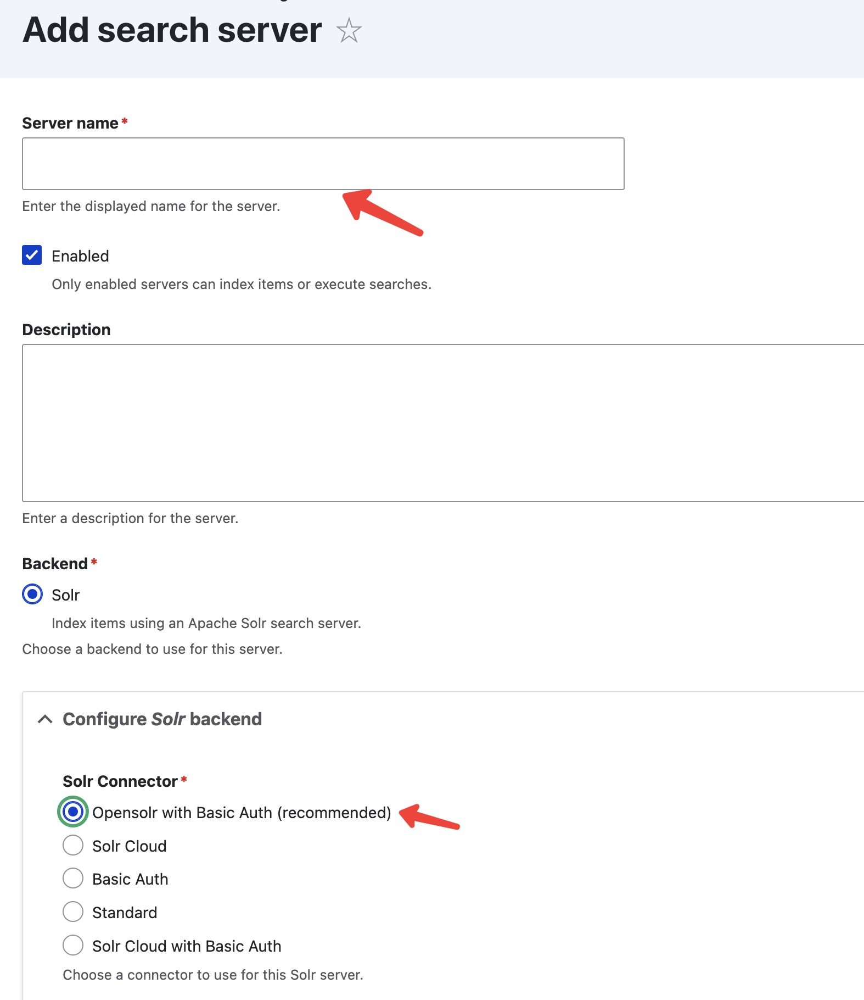
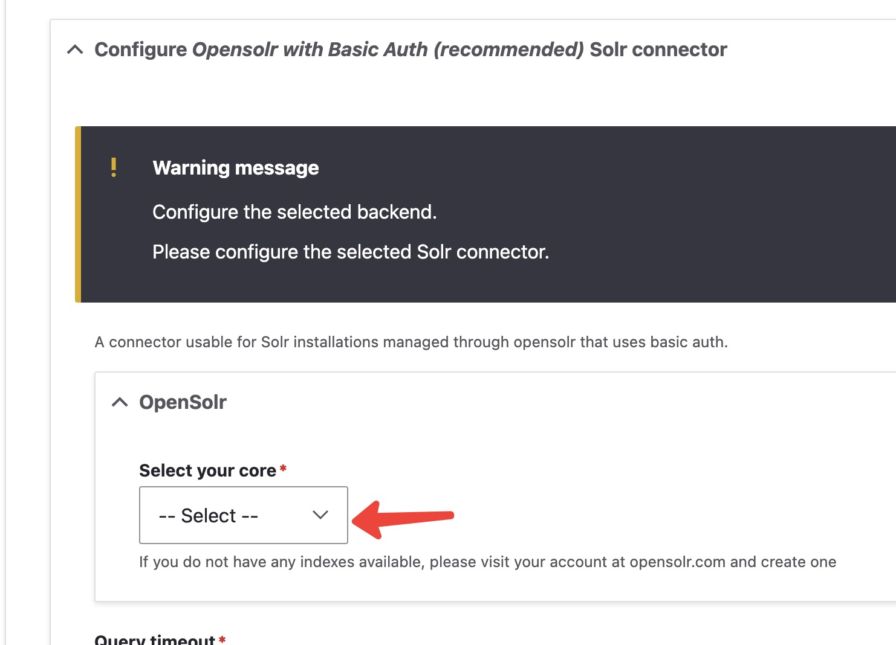
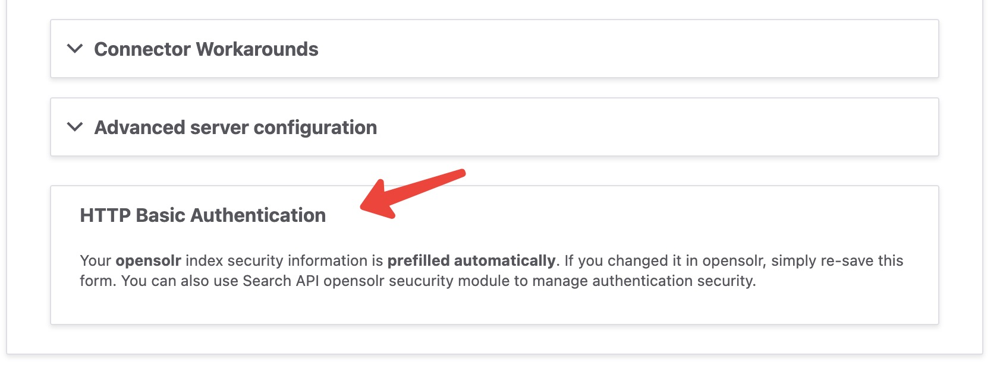

# Search API opensolr

Extends the main Search API Solr module and provides functionality for
connecting and managing solr services using [opensolr](https://opensolr.com)
services.

## Table of contents

- [Requirements](#requirements)
- [Installation](#installation)
- [Automatic Configuration](#configuration-automatic)
- [Manual Configuration](#configuration-manual)
- [Configuration Files](#configuration-files)
- [Maintainers](#maintainers)

## Requirements

The Search API opensolr module depends on Search API Solr module, which will
automatically be downloaded with composer.

There is an **optional** dependency to the [Key](https://www.drupal.org/project/key)
module for people who wish to have more control over managing sensitive keys
like the opensolr API key.

You either need to have an [opensolr account](https://opensolr.com/register), or
the module will automatically create one for you by using the Getting Started
feature.

## Installation

Assuming that your site is
[managed via Composer](https://www.drupal.org/node/2718229), use composer to
download the module. The following command will fetch the latest version.

```
composer require drupal/search_api_opensolr
```

If you want to use the **optional** Key module dependency:

```
composer require drupal/key
```

### Enabling the module

You can manually enable the module from the **Extend** administration menu or
by simply running the drush command below.

```
drush en search_api_opensolr
```

The _Search API opensolr_ module comes with a submodule called _Search API opensolr
security_ that allows you to update your index Basic Auth and set/remove IP
restrictions.

If you want to use it, you can enable it as follows:

```
drush en search_api_opensolr_security
```

If you plan to use the optional Key module dependency:

```
drush en key
```

## Configuration (automatic)

### Get started page

Once the module is installed, navigate to **Configuration → opensolr → Get
started with opensolr**. The page walks you through the four steps and ticks
the ones you have already completed:

1. **Create an Opensolr account** at <https://opensolr.com/register> — every
   new account starts with a 15-day free trial, no credit card required.
2. **Connect this site to your account**: copy your registration email and API
   key from your [Opensolr dashboard](https://opensolr.com/admin/solr_manager/dashboard)
   (Account Settings) into **Configuration → opensolr → Settings** and click
   **Test connection**.
3. **Create your Opensolr index and Search API server** with the
   **Autoconfigure** tab (see below).
4. **Create your Search API index** on the new server, as with any Solr server.

### Autoconfigure the Server

Navigate to **Configuration → opensolr → Autoconfigure**. If you have your
opensolr API configuration in place, you will be presented with a table select
containing the available compatible Solr environments.

Select an environment that best suits your needs, and click on the **Start**
button.


Once submitted, the form will generate a core in your opensolr account and a
Drupal Search API Server connected to that core, and upload the config.zip file
to the opensolr core.

At this point, you are all set up.

## Configuration (manual)

In order to use the full capabilities of this module, you need to first set up
your opensolr API key, otherwise it is unusable.

### Setting the API credentials

Go to **Configuration → Search and Metadata → Search API → OpenSolr** and enter
your [opensolr](https://opensolr.com) email and API key (which can be found in
your Dashboard) and save.

#### Without the Key module

If you are not using the Key module, you can simply paste your key in the Secret
key field.



#### Using the Key module

If you are using the Key module, you need to first create a key by clicking on
the _create a new key_ link below the Secret key field.

After you create the key, you can return to this form and select it from the
select list.



#### Testing your setup

You can verify if your email and API key are correct by clicking on the **Test
connection** button. If your data is correct, then you will receive a
confirmation message saying that the [opensolr](https://opensolr.com) services
were successfully reached.
Otherwise, you will get an error message, and you will not be able to set your
setup until you get the success message.

### Adding your server

**IMPORTANT!** You can skip this step by using the
[Autoconfigure form](#autoconfigure-the-server) above.

Once the API Credentials are ready, you can add your server.

Go to **Configuration → Search and Metadata → Search API** and press the
**Add Server** button.

Enter a server name and from the **Configure SOLR backend / Solr Connector**
section, select the **Opensolr with Basic Auth** Solr Connector.



Once you select the option, you should be presented with the opensolr settings
form and the defaults from Search API. The only thing you need to do is to
choose the core from your [opensolr](https://opensolr.com) account from the
select list. If you do not have any cores in the select list, check your
[opensolr](https://opensolr.com) account.



Basic Authentication is required in opensolr, but this will automatically be set
by the module once you save your Server.



Save your settings and you should have the server up and running.

## Configuration Files

When creating a Server, the module will attempt to automatically export the
configuration files directly to opensolr. If this fails, you can always upload
them manually as follows:

1. Click on the Server name
2. Download the config.zip by pressing the _+Get config.zip_ button
3. Click on the Opensolr tab
4. Under the _Import Config Zip_ sub-tab, upload your downloaded zip file
5. Click on _Upload config zip_ button

## Maintainers

- Cristina B. - [bbu23](https://www.drupal.org/u/bbu23)
- Ciprian Dimofte - [opensolr](https://www.drupal.org/u/opensolr)

---
See full documentation [here](https://www.drupal.org/docs/8/modules/search-api-opensolr).
